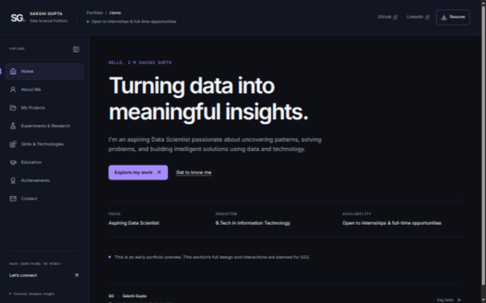
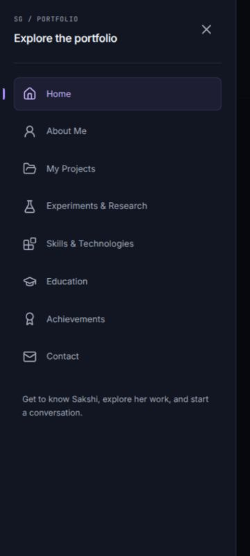
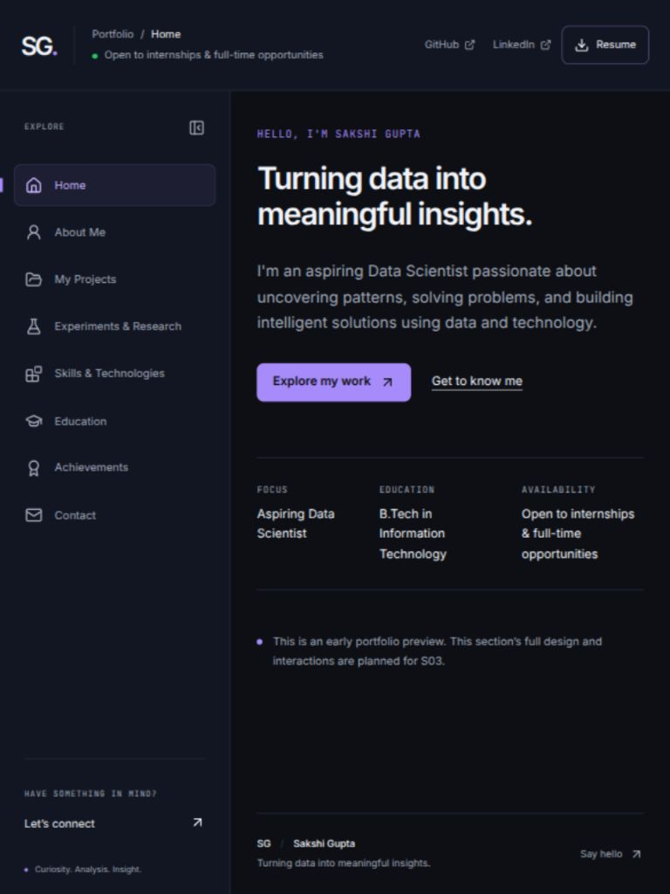

# S02 verification — 2026-11-03, Asia/Kolkata

Scope: visitor → topbar/sidebar/mobile drawer → React Router → existing validated JSON page preview. Shared actions → supplied HTTPS profiles, encoded mailto and versioned static PDF. No API, backend, environment secrets or deployment are involved.

## Implementation

Seven reusable layout components under `src/components/layout/`: `AppShell`, `TopBar`, `DesktopSidebar`, `MobileNavigation`, `NavigationLinks`, `ProfileActions`, `Footer`. Navigation remains defined once in `src/app/navigation.ts`, now including Lucide icons. Existing page bodies, facts, startup scripts, packages and source assets are preserved. Contact preview copy now points at working shared actions. Search is omitted until S09.

- Desktop sidebar starts at 264px at widths ≥1200px; starts collapsed to 80px at 768–1199px. A real button toggles it with Enter/Space and keeps all accessible names. State lasts within the current app session; no localStorage requirement.
- Below 768px, a named menu trigger exposes `aria-expanded`/`aria-controls`. A native `dialog.showModal()` supplies modal background isolation; an explicit Tab/Shift+Tab wrap protects keyboard containment. Close/Escape restores the opener, body scroll is restored, route changes close the dialog and focus main, and resizing to desktop closes/cleans it up.
- Route changes reset scroll and focus `main` after modal cleanup. Nested project pages keep My Projects active. Direct title support and route contracts are preserved.
- Topbar: SG identity, page breadcrumb, confirmed availability, supplied profile links, centralized versioned resume download. Footer: owner name/tagline and encoded email action. Null/unsafe action configuration produces unavailable text without an anchor.

## Commands

| Check | Result |
| --- | --- |
| `npm run check` | PASS after final application edits: strict TypeScript, Oxlint (warnings denied), all seven existing regression tests, content/PDF validation and production build |
| `npm exec -- tsx --tsconfig tsconfig.app.json docs/verification/S02-action-fixtures.ts` | PASS: configured links/download filename, null configuration and unsafe URL fixtures; no owner content modified |
| Content validation | PASS: 10 projects, 50 skills, eight groups; PDF metadata/hash match |
| Production build | PASS: JS 306.62 kB / gzip 95.43 kB; CSS 17.61 kB / gzip 4.72 kB; no dependency additions |
| HTTP versioned resume | PASS: 200 application/pdf, 166,684 bytes, original SHA-256 |
| Source/PDF hashes | PASS: all three unchanged from S01 (below) |
| `git diff --check` | PASS after removing trailing spaces on modified handoff lines; initial check flagged Markdown hard-break whitespace |

Used existing local Vite preview at `http://127.0.0.1:5173/`; root returned HTTP 200. No dependency install was needed. Inline tsx evaluation produced no observable fixture output, so actual assertions were run from the retained fixture file; only the observable file execution is counted above.

Repository inspection found `main` at pre-existing commit `f947f66` (“Completed S01 — Foundation and content architecture.”), superseding the old handoff's untracked/no-commit state. Created `codex/s02-workspace` for these changes. No commits, pushes, reset, deployment or source-asset edits performed by this sprint.

## Browser checks

Used CUA in-app browser against the local dev preview, with actual clicks/keyboard events and read-only DOM checks. Saved screenshots and visually reviewed desktop, 360px mobile, modal drawer and expanded tablet layouts.

| Flow / condition | Result |
| --- | --- |
| All eight normal navigation destinations | PASS: Home, About Me, My Projects, Experiments & Research, Skills & Technologies, Education, Achievements, Contact; matching URL, h1, browser title, active link; route navigation focuses main |
| Desktop collapse/expand using Enter/Space | PASS: 264px ↔ 80px, accessible names retained, content expands without overflow |
| Password Strength project detail | PASS: nested route keeps My Projects active; breadcrumb says Project details; long title wraps |
| Detail reload, browser Back / Forward | PASS: detail survives refresh; history returns to catalog and restores detail |
| Skip navigation | PASS: Tab from reload visibly focuses skip link with solid outline; Enter targets main |
| Drawer at 360px | PASS: named trigger, true/false expanded state, named native modal; Close receives initial focus; body overflow locked |
| Drawer Shift+Tab / Tab wrap | PASS: Close → Contact backwards; Contact → Close forwards; focus remains in modal |
| Escape and explicit Close | PASS: closes drawer, returns focus to Open navigation, unlocks body scroll |
| Drawer route navigation | PASS: About Me route renders, drawer closes, main receives focus, page scroll resets to zero |
| Same-route selection | PASS: drawer closes when selecting the current About Me destination |
| Resize while modal open | PASS: resizing 360 → 768 closes drawer, restores body overflow |
| Unknown route | PASS: friendly recovery page, Page not found breadcrumb; Back to Home works |
| Actual browser resume download | PASS: event returned `/home/ubuntu/Downloads/Sakshi_Gupta_Resume.pdf`; downloaded hash equals source |
| Profile/email destinations | PASS: DOM hrefs match supplied GitHub/LinkedIn and encoded mailto; profile actions use noopener noreferrer with new-tab labels |
| Browser warning/error log | Empty after tested flows |

Final Home width checks: 320, 360, 390, 768, 1024, 1440px. In each case document scroll width equals client width (305, 345, 375, 768, 1024, 1425px respectively; scrollbars account for differences). Visible header controls are at least 44px tall. Sidebar starts collapsed on fresh loads at 768/1024 and expanded at 1440. Manually expanding at 768 also produces no horizontal overflow. Long detail title additionally inspected at 360. Mobile uses a static content-sized topbar; desktop/tablet uses a 104px sticky topbar and sidebar. Temporary viewport overrides reset afterward. Local Home tab marked as a deliverable; existing server left available.

## Preserved assets and limits

Unchanged SHA-256:

- Resume source and actual downloaded copy: `0eeadf37c6a1fb4315648b10ebc5d2e02406425eaf04d5755c62c27cbc65204c`.
- `docs/sources/owner-inputs.json`: `c4c55018eaeba949f29ca8141e8e6a7804b24e60acade040ab5afbedb1fbaf01`.
- `docs/sources/repository-evidence.json`: `11d91da46796e0a3d7909f0a5fb0ab7bcd3762ee5e03975eda113d5ced619567`.

React checklist review: small typed components, stable keys, derived active/page state, effects confined to modal/route synchronization with cleanup, semantic landmarks, native links/buttons, hidden decorative icons, readable focus, no duplicated content database, no new heavy libraries. No serious issue observed in these focused manual checks; no automated accessibility audit or certification claimed.

Page bodies intentionally remain foundation previews for S03 onward. Full route/zoom/contrast/reduced-motion audits remain S11/S12. No Lighthouse score measured, production preview/hosting tested, public profile availability independently verified, mail client launched, or PDF reader UI opened. This sprint verifies the actual download and unchanged PDF bytes; PDF visual readability was reviewed during owner intake. Full resume replacement fixtures, missing-file handling and other resume action surfaces remain S03/S10 scope. Browser automation was in the local in-app browser only; no cross-browser/device certification. S02 has no remaining required work.

